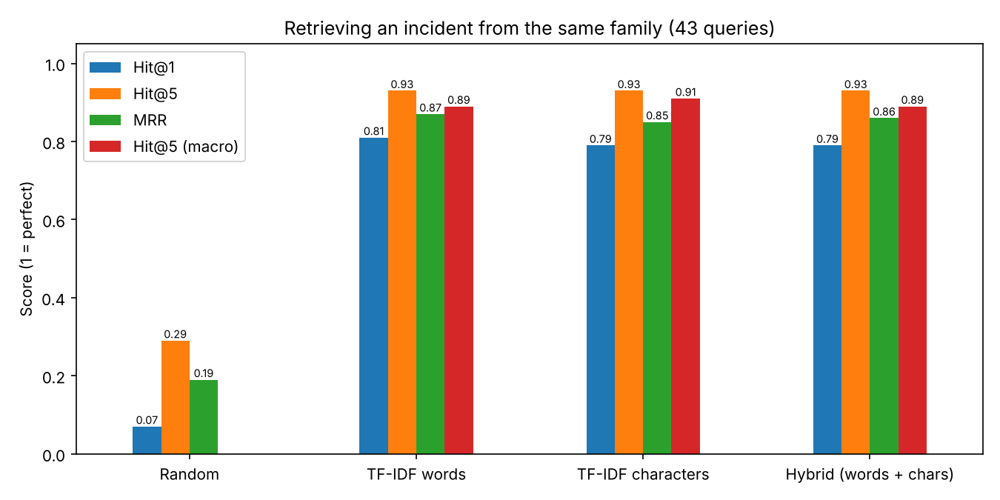

# incident-retrieval

Similar-incident search for an industrial incident log.

When an operator reports an incident, the engine retrieves the most similar past
incidents and shows how they were resolved. The goal: avoid re-investigating a
problem that has already been solved, and spot recurring incidents.

**Data**: incident log from an industrial production site, 206 free-text reports
written in French over about six years. The data is confidential and not included
in this repository. A fictional log is provided so the code can run end to end.

## Approach

1. **Preparation** (`src/prepare.py`): extract the Excel log, clean it
   (inconsistent casing, 2 exact duplicates removed), drop personal columns and
   anonymise incident families. The log structure (sheet, columns, ID format) is
   described in `config.local.json`, excluded from the repository; see
   `config.example.json`.
2. **Retrieval** (`src/search.py`): each incident is represented by the text known
   at reporting time (zone, category, detail, description), vectorised with TF-IDF;
   similarity is measured with cosine similarity. Three variants: word n-grams,
   character n-grams (robust to typos), and a hybrid average of both.
3. **Evaluation** (`src/evaluate.py`): against ground truth built from expert comments.

## Evaluation

In their comments, process engineers had linked some incidents together (a
reference to an earlier incident or to the same root-cause analysis sheet). This
gives 43 incidents in 5 families. For each one, we measure whether the engine
retrieves another member of its family among the 205 other incidents, **without
reading the comments** (otherwise the answer would be handed to the model).

| Method | Hit@1 | Hit@5 | MRR | Hit@5 (macro) |
|---|---|---|---|---|
| Random ranking | 0.07 | 0.29 | 0.19 | – |
| TF-IDF words | 0.81 | 0.93 | 0.87 | 0.89 |
| TF-IDF characters | 0.79 | 0.93 | 0.85 | 0.91 |
| Hybrid (words + chars) | 0.79 | 0.93 | 0.86 | 0.89 |

- **Hit@1**: the first result belongs to the right family.
- **Hit@5**: at least one of the top 5 does.
- **MRR**: mean of 1 / rank of the first correct result.
- **Hit@5 (macro)**: Hit@5 averaged per family, so each family weighs the same.

On complete queries, the three variants perform equally. The robustness test
below separates them.



## Robustness to operator input

`src/robustness_test.py` degrades the query (never the index) and measures Hit@5,
averaged over 20 random draws:

| Query | TF-IDF words | TF-IDF characters | Hybrid |
|---|---|---|---|
| Original | 0.93 | 0.93 | 0.93 |
| Typos (~15% of words) | 0.93 | 0.92 | 0.93 |
| Abbreviations | 0.93 | 0.93 | 0.93 |
| Truncated to 6 words | 0.77 | 0.84 | 0.84 |
| Description only, no zone or category | 0.93 | 0.91 | 0.93 |

The engine is robust to typos and to missing categories. On short descriptions,
character n-grams do clearly better (0.84 vs 0.77), so the **hybrid method is the
default**: it is the most stable across all cases. The abbreviations tested are
rare in the real descriptions, so that test is not very discriminating.

## Limitations

- Small evaluation set: 43 queries, 22 of them in a single family with very similar
  wording. The macro column partly corrects this bias.
- Only expert-linked families are used as ground truth: two unlinked incidents may
  still be genuinely similar.
- TF-IDF matches words, not meaning. The embeddings variant
  (`--method embeddings`, requires `sentence-transformers`) is implemented but not
  yet evaluated.
- A resolution is recorded for only 107 of the 206 incidents.

## Running the demo (no real data needed)

`src/generate_demo.py` creates an **entirely fictional** log
(`demo/fictional_incident_log.csv`, 233 incidents, 12 families) with invented
equipment and scenarios, unrelated to the real log.

```bash
pip install -r requirements.txt
python src/search.py "pression air basse" --data demo/fictional_incident_log.csv
python src/evaluate.py --data demo/fictional_incident_log.csv --out demo/demo_results
```

On this log, every method scores close to 1.00. That figure means nothing: incidents
in a fictional family are generated from the same sentence templates, so they are
nearly identical. Only the results on the real log, above, are meaningful.

## Running on real data

```bash
cp config.example.json config.local.json   # adapt to the log structure
python src/prepare.py path/to/incident_log.xlsx
python src/evaluate.py                     # add --embeddings for the 4th method
python src/robustness_test.py
python src/search.py "dépassement de température à l'étape 8" --k 5
```

## Confidentiality

This repository contains only generic code, a fictional demo log and aggregate
results. The source log, extracted data (`data/`) and local configuration are
excluded by `.gitignore`.
